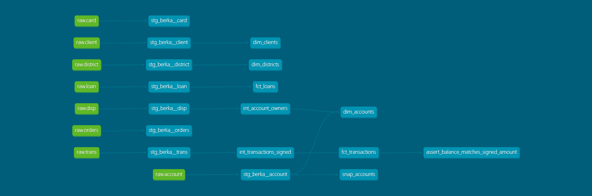

# Berka Bank Analytics (dbt + DuckDB)
This is a dbt project that models the Berka Czech bank dataset (accounts, clients, transactions, loans, and cards) in DuckDB, with tests, an incremental fact table, and an account snapshot.

## Why I built this
I wanted a real dataset where the tables connect and the data isn't perfectly clean. Berka is real, anonymized data from a Czech bank that contains accounts, clients, transactions, loans, and cards. I picked it because I never built a dbt project before. I wanted to practice building facts and dimensions, an incremental load, and a snapshot.

## Why DuckDB
I used DuckDB because it's free and runs on my laptop with no account or billing, so I could focus on learning dbt. A full rebuild of all 15 models, including approximately 1 million transactions, took around one second. I haven't used it in production, and I'm not claiming that a bank would.

## What surprised me
In account 131, on 1995-06-13, there were two transactions. Transaction 40157 was a credit of 15,534, and the balance right after it was also 15,534. The other transaction that day, 40151, was a credit of 1,100 with a resulting balance of 16,634. Because 40157's balance equals its own amount, that means the account was at zero before it, so it must have happened first. The first balance check I ran assumed ID order was the true order, so it flagged correct rows as errors. The singular test I added only checks days with a single transaction, so ID order can't trigger it.

## Architecture



### Staging
The staging layer gives every later model one clean version of each source table. If a column name or type needs fixing, I can fix it in one place. The staging layer renames columns, casts dates and amounts to proper types, and translates the main Czech codes (statement frequency, transaction type, and loan status) into English labels using the dataset author's guide. It doesn't join or filter anything. There are 29 generic tests that check it for unique and not null IDs, relationships, and accepted values. The sources it reads from have freshness checks that use a load timestamp.

### Intermediate
The intermediate layer holds logic that doesn't belong in staging but isn't a final table yet. It has two views. One keeps only the owner of each account, and every account has exactly one owner. The other adds a signed amount, which is positive for credits and negative for debits and cash withdrawals, using a macro so the logic lives in one place. A singular test checks these signs against the real balances on days with a single transaction. Only `dim_accounts` and `fct_transactions` read from these views.

### Marts
The marts layer holds the final tables: three dimensions (`dim_districts`, `dim_clients`, and `dim_accounts`) and two facts (`fct_loans` and `fct_transactions`). Four of them are rebuilt in full on each run. `fct_transactions` is incremental, so it only adds rows with a newer load timestamp. It ended with 1,056,320 rows and no duplicates. `fct_loans` has an `is_problem_loan` column, which is my own definition and not a source field. It marks finished-unpaid and running-in-debt loans. There are 16 generic tests on the marts in addition to the singular balance test.

### Snapshot
The snapshot, `snap_accounts`, keeps the history of account records using SCD Type 2. It checks two columns (statement frequency and district) and when one changes, it closes the old row with an end timestamp and adds a new row. The real data doesn't change, so I simulated it. I changed the statement frequency of five accounts in the raw table from monthly to weekly and ran the snapshot again. Each of those five accounts has two rows now: the old monthly row with an end timestamp and the new weekly row with no end timestamp.

## Data model
| Model | Type | One row per | Key | Built |
| --- | --- | --- | --- | --- |
| `dim_districts` | Dimension | district | `district_id` | Full rebuild |
| `dim_clients` | Dimension | client | `client_id` | Full rebuild |
| `dim_accounts` | Dimension | account | `account_id` | Full rebuild |
| `fct_loans` | Fact | loan | `loan_id` | Full rebuild |
| `fct_transactions` | Fact | transaction | `trans_id` | Incremental |

`fct_loans` and `fct_transactions` join to `dim_accounts` on `account_id`.

## Testing
This project has 46 tests. All of them pass. 45 are generic tests (unique, not null, relationships, and accepted values): 29 on staging and 16 on the marts. One is a singular test: `assert_balance_matches_signed_amount`. The singular test checks that each balance equals the previous balance plus the signed amount, but only on days with a single transaction. It allows a gap of up to 1. In an early check on the 1993 to 1996 data, 98.5% of those rows matched exactly, and the rest were off by exactly 1 in either direction. I haven't confirmed why. The eight sources also have freshness checks.

## What this project doesn't do
This project has a few limits. The data is from the 1990s, which means this project says nothing about how a bank operates today. I loaded the transactions in two batches. The transactions were split at 1997-01-01, only to demonstrate the incremental model. The snapshot changes are also simulated. This resulted in `raw.account` now showing five accounts as weekly that were monthly in the original data. The freshness checks use the time I loaded the data, not the dates in the data, so I expect them to start failing as that time gets older. The `card` and `orders` tables are staged and tested but not used in a mart yet. I only translated three sets of Czech codes. The operation and characterization codes are still in Czech. In the source data, 16,666 transactions have VYBER as their type, which the author's guide lists only as an operation. I treated them as cash withdrawals, and the balance test supports that. Only the mart models have descriptions in the docs.

## How to run it
I used Python 3.13 on Windows. Run these in PowerShell from the project root.

1. Create and activate a virtual environment, then install the packages:

   ```powershell
   python -m venv .venv
   .\.venv\Scripts\Activate.ps1
   pip install -r requirements.txt
   ```

2. Download the raw data from the public CTU Relational Repository. If the connection resets, turn off any VPN and try again:

   ```powershell
   python scripts/download_raw.py
   ```

3. Load the first batch of transactions and build:

   ```powershell
   cd berka_bank
   python scripts/load_raw.py 1
   dbt source freshness
   dbt run
   dbt snapshot
   ```

4. Load the second batch of transactions and rebuild. The incremental model adds only the new rows:

   ```powershell
   python scripts/load_raw.py 2
   dbt run
   ```

5. Simulate the account changes and capture the history:

   ```powershell
   python scripts/simulate_change.py
   dbt snapshot
   ```

6. Run the tests and open the docs:

   ```powershell
   dbt test
   dbt docs generate
   dbt docs serve
   ```